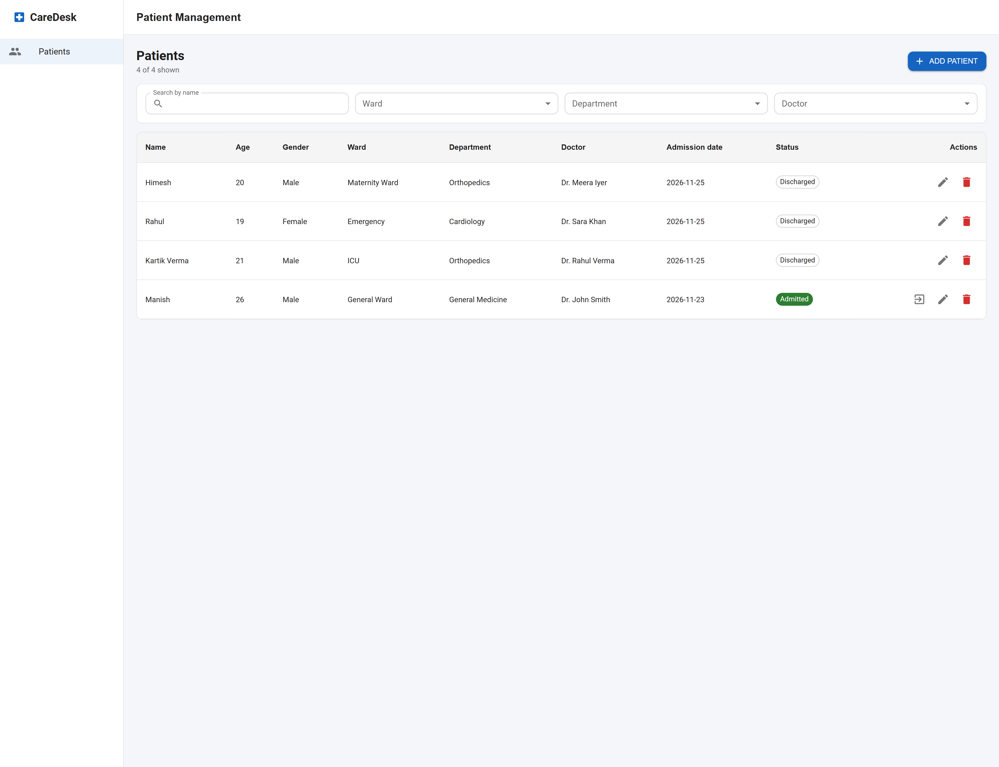
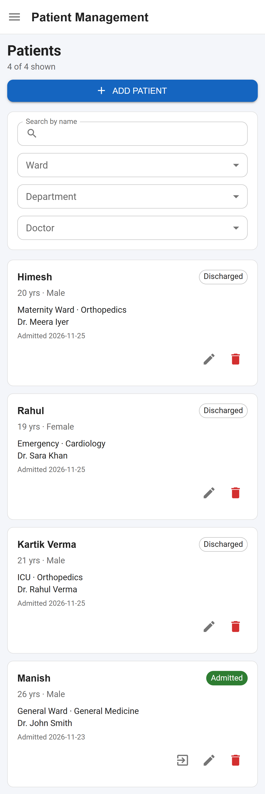
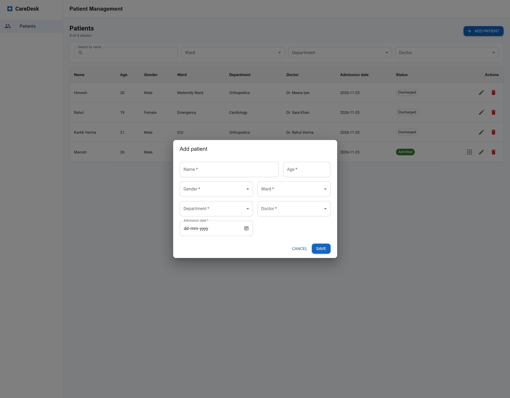

# Patient Admission Management App

Web app for hospital staff to manage admitted patients: add, view, filter, search, edit, delete (with confirmation) and mark as discharged. No login required.

**Live app:** <PASTE FRONTEND URL>
**Live API:** <PASTE BACKEND URL>/api/patients
**Submitted by:** <YOUR FULL NAME>

## Tech stack

| Part | Technology |
|---|---|
| Frontend | React 18, Vite, Material UI |
| Backend | Java 17, Spring Boot 3.5 (Web, Data JPA, Validation, Cache) |
| Database | PostgreSQL (data persists across restarts) |
| Cache | Redis (cached list/search results, evicted on every create/update/delete/discharge) |
| Deployment | Docker, docker-compose |

## Repository layout

```
backend/    Spring Boot REST API  (see backend/README.md for API details)
frontend/   React app
```

## Features

1. Add a patient
2. View the list of all patients
3. Filter by ward, department and doctor
4. Search patients by name
5. Edit a patient
6. Delete a patient (confirmation dialog)
7. Mark a patient as discharged
8. Responsive layout: table on desktop, cards on tablet and mobile

## Validation (frontend and backend)

- Name: required, letters and spaces only
- Age: required, whole number from 0 to 120
- Gender, ward, department, doctor: required, chosen from a list (the frontend loads the lists from `GET /api/meta/options`)
- Admission date: required, cannot be in the future
- The backend rejects invalid data with a `400` and a clear message per field

## Run locally

**1. Backend** (needs Docker; starts the API, PostgreSQL and Redis)

```bash
cd backend
cp .env.example .env        # set POSTGRES_PASSWORD and REDIS_PASSWORD
docker compose up --build   # API on http://localhost:8080
```

**2. Frontend**

```bash
cd frontend
yarn install
yarn dev                    # http://localhost:3000 (proxies /api to localhost:8080)
```

## Configuration

| Where | Variable | Purpose |
|---|---|---|
| frontend (build time) | `VITE_API_BASE_URL` | Backend URL for deployed builds, e.g. `https://my-api.onrender.com/api`. Not needed locally. |
| backend | `DB_URL`, `DB_USERNAME`, `DB_PASSWORD` | PostgreSQL connection |
| backend | `SPRING_DATA_REDIS_URL` (or `REDIS_HOST`) | Redis connection |
| backend | `CORS_ALLOWED_ORIGINS` | Allowed frontend origin(s) |

No passwords or keys are committed. See `backend/.env.example` and `frontend/.env.example`.

## Screenshots

| Desktop | Tablet | Mobile |
|---|---|---|
|  |  |  |

| Add patient | Validation errors | Delete confirmation |
|---|---|---|
|  |  |  |
