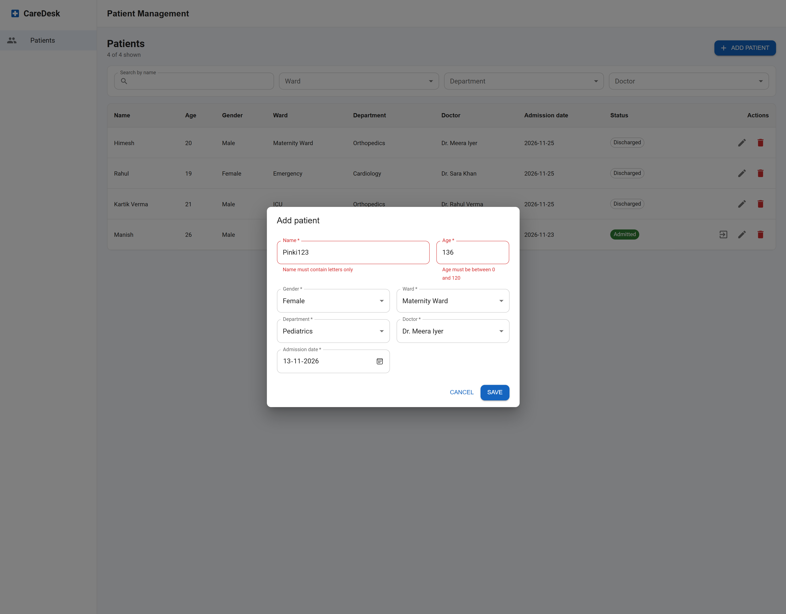
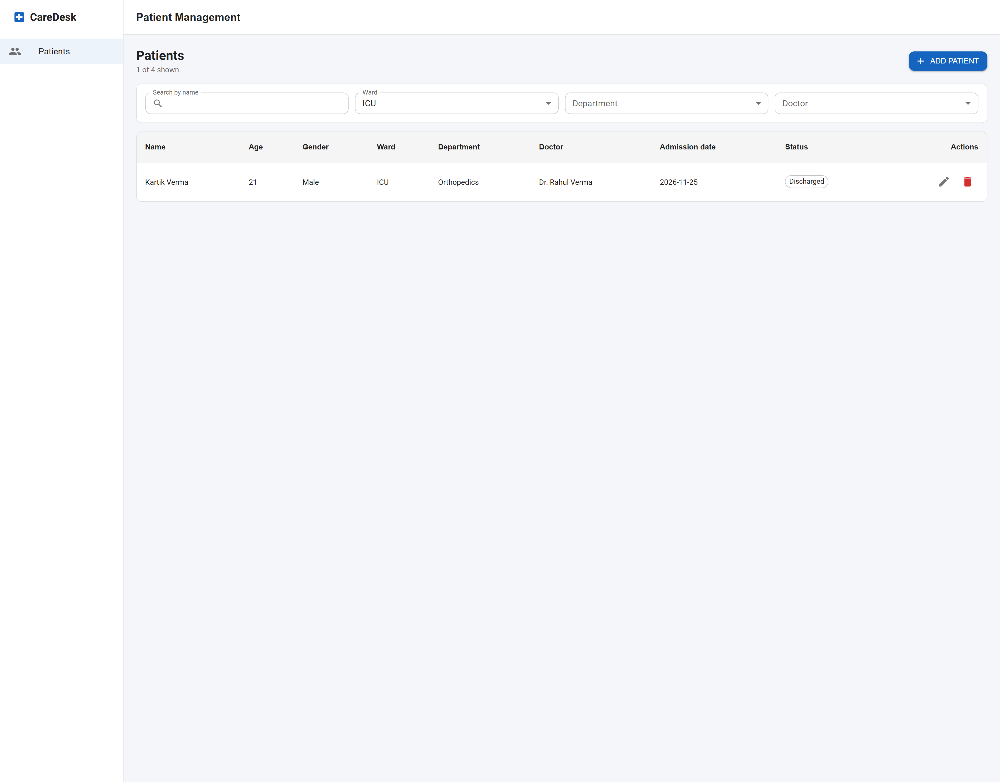
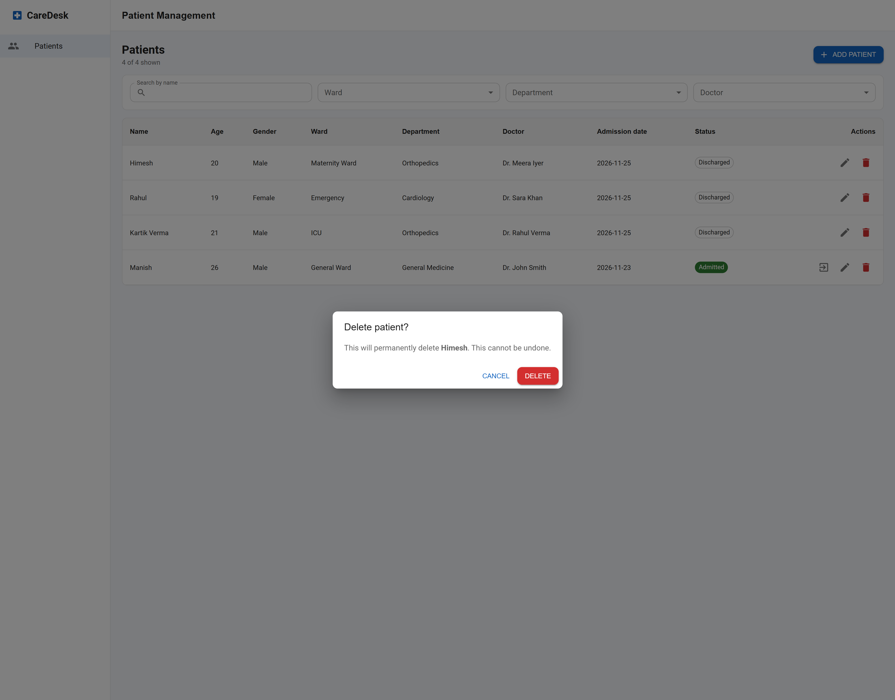

# Patient Admission Management App

A web app for hospital staff to manage admitted patients: add, view, filter, search, edit, delete and discharge. No login or signup is required.

| |                                                        |
|---|--------------------------------------------------------|
| **Live app** | https://patient-admisision-app-frontend.vercel.app/    |
| **Live API** | https://patient-admisision-app.onrender.com/api/patients |
| **Submitted by** | Kartik Verma                                           |

> The backend runs on a free hosting plan that sleeps when idle. If the page shows "Cannot reach the server" or loads slowly, wait about a minute and refresh.

## Screenshots

| Patient list (desktop) | Mobile view |
|---|---|
|  |  |

| Add patient | Validation errors |
|---|---|
|  |  |

| Filter and search | Delete confirmation |
|---|---|
|  |  |

## Features

1. Add a patient
2. View all patients
3. Filter by ward, department and doctor
4. Search patients by name
5. Edit a patient
6. Delete a patient, with a confirmation dialog
7. Mark a patient as Discharged
8. Responsive layout: a table on desktop and cards on tablet and mobile

## Tech stack

| Part | Technology |
|---|---|
| Frontend | React 18, Vite, Material UI |
| Backend | Java 17, Spring Boot 3.5 (Web, Data JPA, Validation, Cache) |
| Database | PostgreSQL, so data persists across restarts |
| Cache | Redis, caching list and search results and evicting them on every change |
| Deployment | Docker and docker-compose; backend and database on Render, frontend on Vercel |

## Project structure

```
backend/    Spring Boot REST API (controller, service, repository, domain, dto, validation, exception, config)
frontend/   React app (pages, components, services, utils, config)
```

## API

Base path: `/api`

| Method | Endpoint | Description |
|---|---|---|
| POST | `/api/patients` | Add a patient (`201 Created`) |
| GET | `/api/patients` | List patients, newest admission first |
| GET | `/api/patients/{id}` | Get one patient |
| PUT | `/api/patients/{id}` | Edit a patient |
| DELETE | `/api/patients/{id}` | Delete a patient (`204 No Content`) |
| PATCH | `/api/patients/{id}/discharge` | Mark as Discharged (`409` if already discharged) |
| GET | `/api/meta/options` | Dropdown values (genders, wards, departments, doctors, statuses) |

Optional query parameters on `GET /api/patients`, combined with AND: `ward`, `department`, `doctor`, `name` (case-insensitive "contains"), `status`.

Example:

```bash
curl -X POST <BACKEND_URL>/api/patients -H "Content-Type: application/json" -d '{
  "name": "Ravi Kumar", "age": 45, "gender": "Male", "ward": "ICU",
  "department": "Cardiology", "doctor": "Dr. Anil Sharma", "admissionDate": "2026-11-20"
}'

curl "<BACKEND_URL>/api/patients?ward=ICU&name=ravi"
```

## Validation

The backend enforces every rule, and the frontend repeats them for quick feedback.

| Field | Rule |
|---|---|
| name | Required, letters and spaces only |
| age | Required, whole number from 0 to 120 |
| gender | Required, one of: Male, Female, Other |
| ward | Required, one of: General Ward, ICU, Maternity Ward, Pediatric Ward, Emergency |
| department | Required, one of: Cardiology, Neurology, Orthopedics, Pediatrics, Oncology, General Medicine |
| doctor | Required, one of: Dr. Anil Sharma, Dr. Meera Iyer, Dr. Rahul Verma, Dr. Sara Khan, Dr. John Smith |
| admissionDate | Required, `yyyy-MM-dd`, cannot be a future date |
| status | `Admitted` (default) or `Discharged` |

Invalid requests return `400` with a clean JSON body that maps each field to its message:

```json
{
  "status": 400,
  "error": "Bad Request",
  "message": "Validation failed",
  "path": "/api/patients",
  "errors": {
    "age": "age must be between 0 and 120",
    "name": "name must contain letters and spaces only"
  }
}
```

A global exception handler also returns the same JSON shape for 404 (unknown id), 409 (already discharged), malformed JSON and unexpected errors.

## Caching

- The list, filter and search results are cached in Redis, one entry per filter combination, and single patients are cached by id.
- Create, update, delete and discharge all evict the affected cache entries, so the list is never stale.
- Entries expire after 10 minutes. If Redis is unavailable, the API falls back to PostgreSQL.

## Run locally

**Backend** (needs Docker; starts the API, PostgreSQL and Redis):

```bash
cd backend
cp .env.example .env          # then set POSTGRES_PASSWORD and REDIS_PASSWORD in .env
docker compose up --build     # API at http://localhost:8080
```

**Frontend:**

```bash
cd frontend
yarn install
yarn dev                      # http://localhost:3000 (proxies /api to localhost:8080)
```

## Configuration

All settings come from environment variables, and no secrets are committed.

| Where | Variable | Purpose |
|---|---|---|
| backend | `DB_URL`, `DB_USERNAME`, `DB_PASSWORD` | PostgreSQL connection |
| backend | `SPRING_DATA_REDIS_URL` (or `REDIS_HOST`) | Redis connection |
| backend | `CORS_ALLOWED_ORIGINS` | Allowed frontend URL(s) |
| backend | `APP_TIMEZONE` | Time zone for the "no future date" rule (default `Asia/Kolkata`) |
| frontend (build time) | `VITE_API_BASE_URL` | Backend API URL, e.g. `https://my-api.onrender.com/api` |

See `backend/.env.example` and `frontend/.env.example`.

## Deployment

- **Database:** Render PostgreSQL
- **Cache:** Render Key Value (Redis-compatible)
- **Backend:** Render Web Service built from `backend/Dockerfile`
- **Frontend:** Vercel, with the project root set to `frontend`